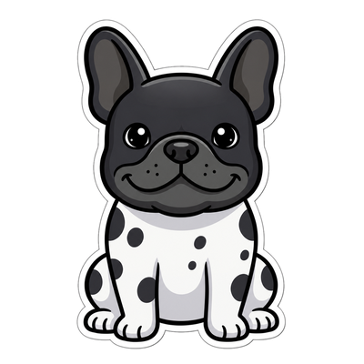

# Буля — пёс-помощник на рабочем столе Windows



Буля живёт поверх окон, реагирует на курсор и события компьютера, общается
по-русски и помогает с повседневными задачами. Вдохновлён настольными питомцами
и Скрепкой из Office. Проект находится на стадии **ранней альфы**.

## Что есть

- Покадровая анимация, эмоции, сон, перетаскивание и выбор окраса.
- Три режима активности: спокойный, обычный и игривый. Короткие цепочки движений,
  отдых с открытыми глазами и сон после пяти минут бездействия за компьютером.
- Чат с выбранной нейросетью, локальная память о предпочтениях и короткие реплики.
- 33 инструмента: запуск приложений, поиск файлов, сайты, погода, YouTube,
  медиаклавиши, заметки, напоминания, создание Word/Excel и заполнение Word-шаблонов.
- Чтение перетащенных текстовых файлов, DOCX, XLSX, PDF с текстовым слоем и изображений.
- Простые команды без нейросети, например «открой Телеграм», «пауза»,
  «напомни через 10 минут размяться».
- Gemini, OpenRouter, OpenAI, DeepSeek, Ollama и OpenAI-совместимый сервер.
  Наличие модели в списке не гарантирует доступность в вашем регионе или аккаунте.

## Скачать для Windows

[Скачать Буля 0.4.0 — Windows x64](https://github.com/FunnyDropeeFMJ/bulya/releases/download/v0.4.0-alpha/Bulya-0.4.0-windows-x64.exe)

[Все файлы и описание альфа-релиза](https://github.com/FunnyDropeeFMJ/bulya/releases/tag/v0.4.0-alpha).
Запуск без установщика. Перед обновлением закройте предыдущего Булю через трей → «Выход».
Память и настройки сохраняются. Сборка пока без цифровой подписи.

## Запуск из исходников

Нужны Windows 10/11 x64, Node.js **22.14 или новее** с npm и интернет для установки
зависимостей. macOS и Linux пока не поддерживаются: часть умений использует Windows API.

```powershell
cd app_frames
npm ci
npm start
```

Или запустите `app_frames/start.bat`. На первом запуске он устанавливает зависимости.
Если Windows не позволяет запускать `npm.ps1`, используйте `npm.cmd ci` и `npm.cmd start`.

При первом запуске откроются настройки нейросети. Выберите провайдера, укажите свой
API-ключ и модель, нажмите «Проверить», затем «Сохранить». Для действий нужна модель
с поддержкой **tools / function calling**; для картинок — ещё и vision.
Названия моделей в пресетах — примеры, их можно заменить в настройках.
Для работы без модели нажмите «Пока без нейросети».

Для Ollama сначала установите сам Ollama и загрузите подходящую модель с поддержкой
инструментов. В настройках Були укажите точное локальное имя модели и адрес
`http://localhost:11434/v1`. Скорость и требования к RAM/VRAM зависят от выбранной модели.
Веб-поиск, погода и YouTube всё равно используют интернет.

Один клик по Буле открывает чат. Файл можно перетащить на персонажа. Контекстное
меню и значок в трее открывают одинаковые команды: помощь, игры, эмоции,
поведение, внешность, нейросеть, память и выход. «Поговорить с Булей» открывает
чат, «Помощь → Поставить напоминание…» подставляет заготовку без отправки запроса.
Режим активности выбирается в «Поведение → Активность» и сохраняется.

## Данные и ограничения

При облачной модели сервер получает текст беседы, выбранные воспоминания,
содержимое приложенных документов и результаты вызванных инструментов.
Эвристический фильтр маскирует распознанные телефоны, ФИО и некоторые другие данные,
включая имена файлов. **Он может ошибаться и не гарантирует анонимность.**
Изображения передаются без маскирования; перед отправкой приложение спрашивает разрешение.
API-ключ отправляется настроенному серверу для авторизации.
Подробности — в [PRIVACY.md](app_frames/PRIVACY.md).

Модель может ошибиться в ответе или выборе инструмента. Буля не заменяет
проверку готового документа человеком. Закрытие программы требует подтверждения.
Произвольного исполнения shell-команд через LLM в приложении нет.

Память и зашифрованный ключ находятся в `%APPDATA%\bulya-helper-frames\`.
Документы и заметки создаются в пользовательской папке `Документы\Буля`.
Отключить собственные реплики и реакции можно в меню «Поведение» по ПКМ или в трее.
«Забыть всё о хозяине» удаляет профиль и воспоминания, но сохраняет сейф;
команда «Забыть разговор» очищает текущий контекст чата отдельно.

## Проверки и сборка Windows

Из `app_frames`:

```powershell
npm test
npm run check
npm run pack:win
npm run dist:win
```

`npm test` проверяет реальную логику с подменой сетевого ответа и нативной границы
Electron. Он не читает `.env`, не использует настоящую память и не тратит API-кредиты.
Отдельная [проверка провайдера](docs/TESTING.md) запускается только явно.

`pack:win` создаёт папку приложения, `dist:win` — один portable EXE в `app_frames/dist/`.
Portable означает запуск без установщика; память всё равно хранится в AppData.
Сборка не подписана сертификатом разработчика. CI создаёт артефакт для скачивания,
но автоматически не публикует релиз.

Перед публичным релизом пройдите [ручной список проверок](docs/RELEASE.md).
Выполненные проверки и оставшиеся шаги записаны в [PREPARATION_STATUS.md](docs/PREPARATION_STATUS.md).

## Структура

- `app_frames/` — текущая версия Electron, персонаж и умения.
- `app_frames/tests/` — поддерживаемые автоматические проверки.
- `scripts/` — проверка состава проекта и экспорт чистых исходников.
- `docs/` — тестирование, выпуск, описание графики и черновик поста.

В рабочей папке автора могут оставаться старые версии и материалы генерации.
Они исключены из Git и экспорта. Исторические `test_*.js` не входят в поддерживаемую
тестовую команду: их заменили автономные серии в `tests/`.

## Лицензия и графика

MIT — см. [LICENSE](LICENSE). Графика персонажа создавалась с помощью генеративных
моделей; происхождение и границы лицензирования описаны в [ASSETS.md](docs/ASSETS.md).
Зависимости распространяются по собственным лицензиям.
